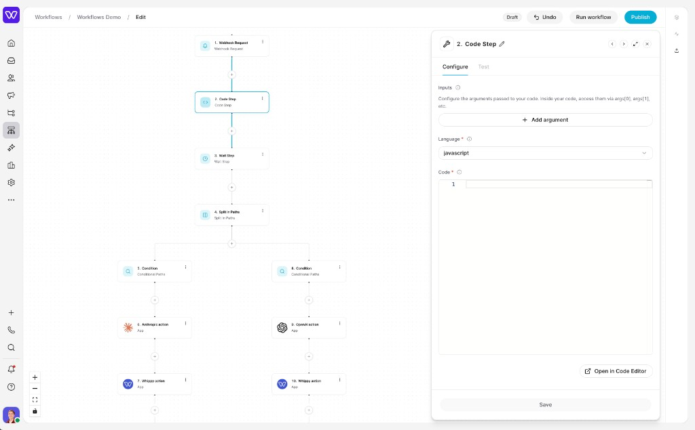

# Getting started with `ww-cli`

This guide is for **external** developers building Whippy workflow apps. You only need this CLI, Node.js, a Whippy API key, and your vendor’s API docs.

Your app’s actions show up as **App steps** in the Whippy workflow builder (alongside triggers, code, conditions, and other steps):



## 1. Install the CLI

```bash
cargo install --git https://github.com/hellowhippy/ww-cli --locked
ww-cli --help
```

Ensure `~/.cargo/bin` is on your `PATH`.

## 2. Log in

1. Open your Whippy account and go to **Developers → API keys**:  
   [https://app.whippy.co/developer/keys](https://app.whippy.co/developer/keys)  
   Create a key (or copy an existing one) for your organization.
2. Run:

```bash
ww-cli login
```

Paste the key when prompted. Credentials are stored in `~/.whippyrc` (`api_key`, `api_url`). Production workflows API is `https://workflows.whippy.ai`.

## 3. Scaffold an app

```bash
ww-cli init my-app --language typescript --auth custom
cd my-app
```

Use `--auth custom` for API-key vendors so the Whippy Connect form renders (the scaffold’s
`api_key` auth type does **not** show a Connect form). Use `--auth oauth2` when your vendor
uses OAuth.

## 4. Implement actions

A workflow app exposes:

- **searches** — reads / list / lookup (also power dynamic dropdowns)
- **creates** — mutations (create / update / delete / send)
- **triggers** — webhook entry points

Handlers are async functions that receive `(w, bundle)`. Use `w.request` for HTTP — do not call raw `fetch` for vendor calls when `w.request` is available.

Keep one handler per file under `src/` and register them from `src/index.ts`.

## 5. Local loop

Always run CLI commands from the **app root** (where `src/index.ts` lives):

```bash
ww-cli build      # after meaningful code changes
ww-cli validate   # necessary but not sufficient for production quality
```

Create `test-data.json` (do **not** commit secrets) from any example file in the scaffold, then:

```bash
ww-cli invoke authentication.test --data test-data.json
ww-cli invoke <action_key> --data test-data.json
```

If `invoke` fails with sharp/Node errors, install Wrangler 3.x:

```bash
npm install -g wrangler@3.114.1
```

## 6. Publish a version

Bump `version` in your app’s `package.json` (semver). Then:

```bash
ww-cli push --create        # first publish only (creates the app + draft version)
ww-cli push                 # later bumps (requires existing .whippyapprc from --create)
ww-cli versions             # inspect remote versions
ww-cli promote 1.0.0        # publish when ready
```

Plain `ww-cli push` without `--create` fails until the app exists locally (`.whippyapprc`).
`push` also rejects a version lower than the highest semver already on the server — bump
`package.json` to move forward.

**Agents / automation:** prefer `build` / `validate` / `invoke` only. Let a human run `push` / `promote` unless they explicitly ask.

## 7. Test in the Whippy builder

After promote, open the workflow builder in your Whippy account, add an **App** step, connect the account, pick your action, and run a step test. Downstream steps map fields from your `sample` / `output_fields`.

## Common gotchas

| Symptom | Fix |
|--------|-----|
| Push/login hits the wrong environment | Check `~/.whippyrc` `api_url`; remove the file and `ww-cli login` again for production |
| `validate` passes but the builder form looks wrong | Re-check `input_fields` types and samples; rebuild and re-push |
| First-time publish permission errors | Confirm your API key belongs to an org that can create workflow apps |
| macOS logo processing fails | `brew install vips` |

## Next: best practices and AI skills

- [Best practices](./BEST_PRACTICES.md) — auth, fields, samples, deploy conventions.
- [AI skills](../skills/README.md) — install `building-workflow-apps` into Cursor (or other agents) so they follow the same contract.

## What this CLI is not

- It is **not** the Whippy product API for SMS/email/contacts.
- It does **not** require Docker or a local Whippy API.
- It does **not** replace the visual workflow builder — it ships the **apps** that appear inside that builder.
